# Implementation Specification: `agy-cursor-bridge`

> **A High-Performance, OpenAI-Compatible Routing Layer Exposing the Antigravity (`agy`) CLI & Agent to Cursor IDE**

---

## 1. Executive Summary & Vision

Cursor is an AI-first code editor that natively supports custom LLM providers via an **OpenAI-Compatible Base URL** and **API Key**. 

**The Goal:** Provide a lightweight, robust, zero-latency Python routing layer (`agy-cursor-bridge`) that bridges Cursor's native Agent, Composer, Chat, and Inline-Edit interfaces directly to the local **Antigravity (`agy`) CLI**. 

### Key Capabilities
1. **Zero-Configuration Authentication:** Leverages the user's active `agy` local credentials (`~/.gemini/antigravity-cli/antigravity-oauth-token`). No separate Google Vertex API keys, Anthropic keys, or OpenAI credits required.
2. **True Low-Latency SSE Streaming:** Translates `agy`'s native NDJSON real-time stream (`stream-json` mode) into strict OpenAI Server-Sent Events (`choices[0].delta.content`) with zero buffer lag.
3. **Cursor Agent & Responses API Compatibility:** Seamlessly handles both standard Chat Completions schemas (`messages: [{role, content}]`) and Cursor's internal Responses API format (`input: [...]`, `stream_options`, reasoning tags).
4. **Autonomous Agent vs. Pure LLM Modes:** Enables users to run Antigravity as an autonomous full-workspace agent (performing file modifications and terminal operations with live feedback streamed into Cursor) or as a fast model provider for Cursor's own native tools.
5. **Stateful Conversation Preservation:** Intelligently maps Cursor's multi-turn message history to `agy`'s native `--conversation <id>` threads, preserving context across extended coding sessions.
6. **Built-in Network Tunneling:** Supports one-flag tunneling (`--tunnel`) via Cloudflare Tunnel (`cloudflared`) to bypass Cursor's cloud verification servers (`api2.cursor.sh`), ensuring local endpoints always connect without firewall or DNS friction.

---

## 2. System Architecture

```mermaid
flowchart TD
    subgraph CursorIDE["Cursor IDE (Client / Cloud)"]
        UI["Chat / Composer / Agent Window"]
        CBackend["Cursor Cloud Verification (api2.cursor.sh)"]
    end

    subgraph Bridge["agy-cursor-bridge (Python / FastAPI)"]
        Router["FastAPI Router (/v1 & /cursor)"]
        Norm["Request Normalizer (OpenAI + Responses API)"]
        SessMgr["Session & Conversation Manager (LRU Cache)"]
        Driver["Async agy Subprocess Driver"]
        SSEGen["OpenAI SSE Stream Formatter"]
        CF["Cloudflare Tunnel (cloudflared optional)"]
    end

    subgraph LocalHost["Local Machine Execution"]
        AgyCLI["Antigravity CLI (agy)"]
        AuthStore["~/.gemini/antigravity-cli/antigravity-oauth-token"]
        Workspace["Local Workspace Codebase"]
    end

    subgraph GoogleBackend["Google GenAI Interaction Service"]
        Gemini38["Gemini 3.8 Flash / Pro (High Reasoning)"]
        Claude37["Claude 3.7 Sonnet / DeepSeek R1"]
    end

    UI -->|"POST /v1/chat/completions (SSE)"| Router
    CBackend -->|"GET /v1/models (Key validation)"| Router
    CF -.->|"Public Ingress (if enabled)"| Router
    Router --> Norm
    Norm --> SessMgr
    SessMgr --> Driver
    Driver -->|"Spawns agy -p ... --output-format stream-json"| AgyCLI
    AgyCLI -->|"Reads OAuth token"| AuthStore
    AgyCLI <--> Workspace
    AgyCLI <-->|"Encrypted gRPC / WebChannel"| GoogleBackend
    AgyCLI -->|"Stdout (NDJSON stream)"| SSEGen
    SSEGen -->|"data: {'choices': [{'delta': ...}]}"| UI
```



---

## 3. Protocol Deep-Dive & Request Translation

### 3.1 Cursor Endpoint Matrix
Cursor sends requests against multiple paths depending on whether the user configures `http://localhost:8000/v1` or `http://localhost:8000/cursor`:

| Endpoint Path | Method | Purpose |
| :--- | :--- | :--- |
| `/v1/models` | `GET` | Cursor verifies the API key and lists available models in the dropdown |
| `/v1/models/{model_id}` | `GET` | Fetches single model metadata |
| `/v1/chat/completions` | `POST` | Core Chat, Composer, and Agent completion endpoint |
| `/cursor/models` | `GET` | Cursor-specific model listing (LiteLLM compatibility) |
| `/cursor/v1/models` | `GET` | Secondary Cursor model discovery |
| `/cursor/chat/completions` | `POST` | Cursor-specific completion route |
| `/health` | `GET` | Health check for tunnel and supervisor daemons |

### 3.2 Dual Request Payload Normalization
Cursor sends two distinct payload shapes:

#### Format A: Standard OpenAI Chat Completions
```json
{
  "model": "gemini-3.8-flash",
  "messages": [
    {"role": "system", "content": "You are a coding assistant."},
    {"role": "user", "content": "Refactor src/main.py"}
  ],
  "stream": true,
  "temperature": 0.7
}
```

#### Format B: Cursor Agent / Responses API Shape
When Cursor runs in Agent mode or uses advanced reasoning models, it may send an `input` array rather than `messages`:
```json
{
  "model": "gemini-3.8-pro",
  "input": [
    {"type": "message", "role": "user", "content": "Fix failing tests"}
  ],
  "stream": true,
  "stream_options": {"include_usage": true}
}
```

#### Normalizer Strategy (`request_normalizer.py`):
1. **Unified Message Extraction:** Extract all turns into a standardized list `[(role, text)]`.
2. **System Prompt Preservation:** Extract `system` or `developer` instructions and prepend them with clear demarcation (`[System Instructions] ...`).
3. **Turn Merging:** Assemble the active user prompt and context documents into a clean prompt string for `agy`.
4. **Model Name Sanitization:** Map Cursor model aliases to Antigravity model identifiers:
   - `gemini-3.8-flash` / `gemini-flash` -> `gemini-3.8-flash`
   - `gemini-3.8-pro` / `gemini-pro` -> `gemini-3.8-pro`
   - `claude-3-7-sonnet` -> `claude-3-7-sonnet`
   - `deepseek-r1` -> `deepseek-r1`
   - `cursor-agent` / `auto` / `default` -> `auto`

---

## 4. Subprocess Execution & Stream Pipeline

### 4.1 Invoking `agy`
The bridge runs `agy` non-interactively via `asyncio.create_subprocess_exec` using its headless streaming flags:

```bash
agy \
  --conversation <conversation_id> \
  --model <model_name> \
  --mode <auto|plan|accept-edits> \
  --effort <high|medium|low> \
  --dangerously-skip-permissions \
  --output-format stream-json \
  -p "<compiled_prompt>"
```

### 4.2 NDJSON Stream Event Decoding
`agy` emits newline-delimited JSON events over `stdout`:

```json
{"event":"init","conversation_id":"c5445c09-f84a-4c2d-9766-b5ac0e9cd35c","init":{"cwd":"/path/to/project"}}
{"event":"step_update","step_update":{"conversation_id":"...","step_index":1,"state":"ACTIVE","step_type":"agent_response","text_delta":"Hello"}}
{"event":"step_update","step_update":{"conversation_id":"...","step_index":1,"state":"ACTIVE","step_type":"agent_response","text_delta":" there!"}}
{"event":"step_update","step_update":{"conversation_id":"...","step_index":1,"state":"DONE","usage":{"input_tokens":15392,"output_tokens":207}}}
{"event":"result","result":{"conversation_id":"...","status":"SUCCESS","response":"Hello there!\n"}}
```

### 4.3 OpenAI SSE Transformation (`stream_parser.py`)
Each event is transformed in real-time into OpenAI SSE chunks:

```text
data: {"id":"chatcmpl-c5445c09","object":"chat.completion.chunk","created":1760553400,"model":"gemini-3.8-flash","choices":[{"index":0,"delta":{"role":"assistant","content":""},"finish_reason":null}]}

data: {"id":"chatcmpl-c5445c09","object":"chat.completion.chunk","created":1760553400,"model":"gemini-3.8-flash","choices":[{"index":0,"delta":{"content":"Hello"},"finish_reason":null}]}

data: {"id":"chatcmpl-c5445c09","object":"chat.completion.chunk","created":1760553400,"model":"gemini-3.8-flash","choices":[{"index":0,"delta":{"content":" there!"},"finish_reason":null}]}

data: {"id":"chatcmpl-c5445c09","object":"chat.completion.chunk","created":1760553400,"model":"gemini-3.8-flash","choices":[{"index":0,"delta":{},"finish_reason":"stop"}],"usage":{"prompt_tokens":15392,"completion_tokens":207,"total_tokens":15599}}

data: [DONE]
```

### 4.4 Reasoning / Thought Handling
When `agy` emits reasoning thoughts (`thought_delta`), the bridge provides two configurable strategies:
- **Strategy A (DeepSeek/OpenAI `reasoning_content`):** Emits `choices[0].delta.reasoning_content`, which Cursor's reasoning-compatible UI renders in its native expandable thinking block.
- **Strategy B (Markdown Collapsible Tags):** Wraps thoughts in `<thought>\n...\n</thought>` blocks so standard chat renderers display them cleanly without polluting code blocks.

---

## 5. Multi-Turn Session Continuity

Cursor's Chat Completions protocol is stateless: it sends the entire conversation history in every turn. In contrast, `agy` maintains rich conversation history on disk (`~/.gemini/antigravity-cli/conversations/<id>/`) and indexes trajectories with git snapshots and terminal states.

### Session Mapping Algorithm (`session_manager.py`)
1. **Conversation Hash Key:** Compute a deterministic SHA-256 hash of the initial system message and first user prompt.
2. **Session Registry:** Maintain an in-memory LRU cache mapping `hash(initial_turns)` -> `agy_conversation_id`.
3. **Turn Execution:**
   - On the **first turn**: Spawn `agy -p "<prompt>" --output-format stream-json`. Capture the returned `init.conversation_id` and store it in the registry.
   - On **subsequent turns**: Detect existing session from the conversation prefix hash. Extract only the latest user message and invoke `agy --conversation <id> -p "<latest_prompt>" --output-format stream-json`.
4. **Session Expiry & Eviction:** Sessions idle for > 2 hours are pruned from memory while remaining preserved in Antigravity's local database.

---

## 6. Networking & Zero-Config Cloudflare Tunnel

### The Cursor Cloud Verification Problem
When a user configures **Override OpenAI Base URL** in Cursor Settings, Cursor often initiates verification requests from its cloud backend (`api2.cursor.sh`). If the user specifies `http://localhost:8000/v1`, Cursor Cloud cannot reach local loopback addresses, causing Cursor to hang or show connection errors.

### The Solution: Built-in Quick Tunnel
`agy-cursor-bridge` includes native support for Cloudflare Quick Tunnels:
- Run with `agy-cursor serve --tunnel`.
- Automatically starts a local `cloudflared` tunnel (or downloads a standalone binary into cache if absent).
- Outputs a secure public HTTPS endpoint:
  ```text
  ┌─────────────────────────────────────────────────────────────┐
  │  🚀 agy-cursor-bridge is live!                              │
  │                                                             │
  │  Local Base URL:   http://127.0.0.1:8000/v1                 │
  │  Public Tunnel:    https://hyper-ag-tunnel.trycloudflare.com/v1 │
  │  API Key:          agy-live                                 │
  └─────────────────────────────────────────────────────────────┘
  ```
- Users can paste either the local URL (for direct connections) or the public tunnel URL (if Cursor Cloud validation is required) with zero manual port forwarding.

---

## 7. Open-Source Repository Structure

```text
oss/agy-cursor-bridge/
├── pyproject.toml               # Poetry/Hatch build configuration & dependencies
├── README.md                    # Quickstart, Cursor screenshots & configuration guide
├── LICENSE                      # Apache 2.0 / MIT
├── IMPLEMENTATION.md            # Architectural specification (this file)
├── Dockerfile                   # Containerized deployment option
├── Makefile                     # Developer tasks: lint, test, format, run
├── src/
│   └── agy_cursor_bridge/
│       ├── __init__.py          # Package version & exports
│       ├── cli.py               # Typer/Argparse CLI (`agy-cursor serve`, `models`, `check`)
│       ├── server.py            # FastAPI application factory & CORS configuration
│       ├── config.py            # Pydantic Settings (ports, host, virtual key, timeouts)
│       ├── routes/
│       │   ├── __init__.py
│       │   ├── completions.py   # /v1/chat/completions & /cursor/chat/completions
│       │   ├── models.py        # /v1/models & /cursor/models
│       │   └── health.py        # /health & /v1/health
│       ├── core/
│       │   ├── __init__.py
│       │   ├── agy_driver.py    # Subprocess execution & process pooling
│       │   ├── stream_parser.py # NDJSON -> OpenAI SSE chunk generator
│       │   ├── normalizer.py    # Request payload normalization (OpenAI + Responses API)
│       │   ├── session_store.py # Multi-turn conversation mapping & LRU cache
│       │   ├── tunnel.py        # Cloudflare Quick Tunnel manager
│       │   └── auth.py          # Antigravity local credential validator
│       └── models/
│           ├── __init__.py
│           └── openai_types.py  # Pydantic schemas for completions, chunks & models
└── tests/
    ├── conftest.py              # Test fixtures and mock agy process helpers
    ├── test_server.py           # Integration tests for FastAPI endpoints
    ├── test_normalizer.py       # Unit tests for Cursor input transformations
    ├── test_stream_parser.py    # Unit tests for NDJSON -> SSE translation
    └── test_session_store.py    # Unit tests for conversation continuity
```

---

## 8. Detailed Step-by-Step Implementation Plan

### Phase 1: Foundation & Authentication Check
- [x] Create Python project scaffolding (`pyproject.toml`) with dependencies: `fastapi`, `uvicorn`, `pydantic>=2.0`, `typer`, `httpx`.
- [x] Implement `core/auth.py` to check for `~/.gemini/antigravity-cli/antigravity-oauth-token` and run `agy models` to verify local authentication.
- [x] Build `cli.py` with commands:
  - `agy-cursor check`: Tests local `agy` status, models, and credentials.
  - `agy-cursor models`: Prints live available models from `agy`.
  - `agy-cursor serve`: Starts the bridge server.

### Phase 2: FastAPI Server & Model Discovery
- [x] Implement `server.py` with FastAPI, setting up permissive CORS, chunked transfer support, and error interceptors.
- [x] Implement `routes/models.py`:
  - Dynamically query `agy models` or cache the model roster.
  - Expose `/v1/models`, `/cursor/models`, and `/cursor/v1/models` in standard OpenAI schema (`{"object": "list", "data": [...]}`).

### Phase 3: Request Normalizer & Subprocess Driver
- [x] Implement `core/normalizer.py`:
  - Parse both OpenAI `messages` format and Cursor `input` Responses API format.
  - Extract active prompt, history context, and system instructions.
- [x] Implement `core/agy_driver.py`:
  - Asynchronously spawn `agy` with `--output-format stream-json`, `--dangerously-skip-permissions`, `--model <model>`, and `-p <prompt>`.
  - Provide asynchronous line generator reading NDJSON from stdout.
  - Handle process timeouts, cancellation signals, and unexpected exits.

### Phase 4: Real-Time SSE Stream Transformer
- [x] Implement `core/stream_parser.py`:
  - Map `text_delta` to `choices[0].delta.content`.
  - Map `thought_delta` to `reasoning_content` or `<thought>` blocks.
  - Emit usage tokens upon `result` event.
  - Emit terminal `data: [DONE]`.
  - Ensure zero output buffering via `StreamingResponse(..., media_type="text/event-stream")`.

### Phase 5: Stateful Session Management
- [x] Implement `core/session_store.py`:
  - Track conversation history hashes.
  - Map conversation IDs so multi-turn Cursor dialogues reuse `agy --conversation <id>`.

### Phase 6: Built-in Cloudflare Tunnel Integration
- [x] Implement `core/tunnel.py`:
  - Check for existing `cloudflared` binary or provide automated run.
  - Extract public tunnel hostname and display clean startup banner with copy-pasteable URLs for Cursor.

### Phase 7: Verification & Testing
- [x] Unit tests for stream parsing, normalizer edge cases, and session hashing.
- [x] End-to-end integration test with live Cursor IDE:
  - Test Cursor Settings model verification (`GET /v1/models`).
  - Test Cursor Chat (`Cmd+L`).
  - Test Cursor Composer / Agent (`Cmd+I`).
  - Test inline code generation (`Cmd+K`).

---

## 9. Cursor Setup Quickstart Guide

1. **Start the Bridge:**
   ```bash
   agy-cursor serve --port 8000
   ```
   *(Or with public tunnel if Cursor cloud verification is used: `agy-cursor serve --tunnel`)*

2. **Open Cursor Settings:**
   - Navigate to `Settings` -> `Cursor Settings` -> `Models`.
   - Scroll down to **OpenAI API Key**:
     - Enter virtual key: `agy-live`
   - Enable **Override OpenAI Base URL**:
     - Enter: `http://127.0.0.1:8000/v1` *(or public tunnel URL)*
   - In **Model Names**, add any model enabled in your Antigravity tier:
     - `gemini-3.8-flash`
     - `gemini-3.8-pro`
     - `claude-3-7-sonnet`
     - `deepseek-r1`
3. **Verify Connection:**
   - Click Cursor's **Verify** button next to the API key.
   - The bridge responds instantly with `200 OK` on `/v1/models`.
4. **Code with Antigravity inside Cursor:**
   - Open Cursor Agent (`Ctrl+I` / `Cmd+I`), select `gemini-3.8-flash`, and enjoy real-time streaming with Antigravity speed and capabilities!
